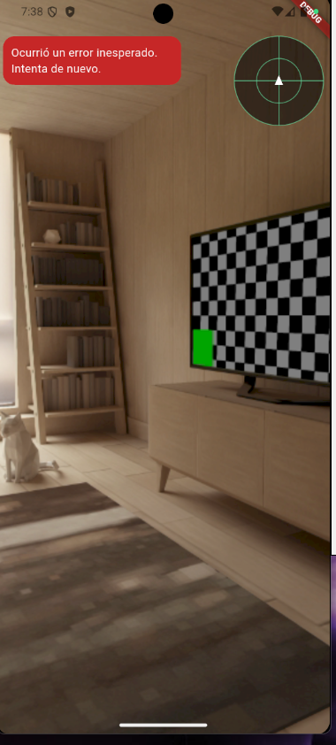
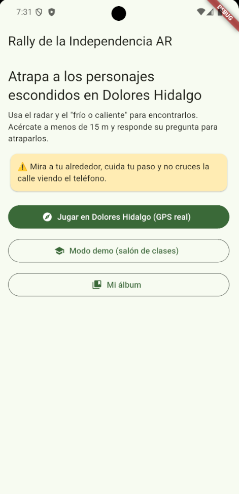
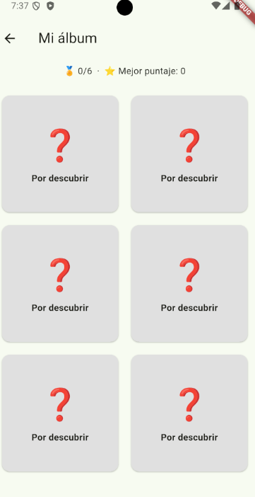
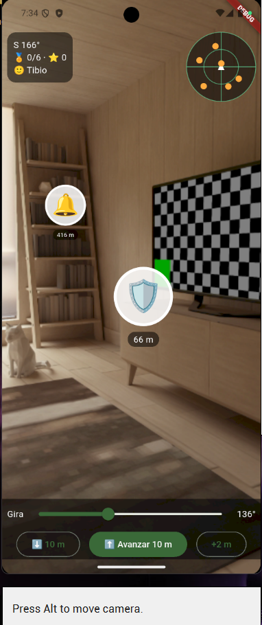

# Rally de Realidad Aumentada - Dolores Hidalgo

Rally de realidad aumentada por Dolores Hidalgo: atrapa personajes de la Independencia.

## 📱 Pantallas de la Aplicación

Aquí puedes ver las vistas principales del sistema y su flujo en realidad aumentada:

| Vista de Juego (AR) | Pantalla de Login |
| :---: | :---: |
|  |  |
| *Captura de la experiencia en Realidad Aumentada* | *Pantalla de acceso al sistema* |

| Mi Álbum | Salón de Clases (AR) |
| :---: | :---: |
|  |  |
| *Colección de personajes descubiertos* | *Interfaz de interacción en el aula* |

---

## 🚀 Tecnologías Utilizadas
- **Flutter** (Framework multiplataforma)
- **Dart**
- **Realidad Aumentada (AR)**
